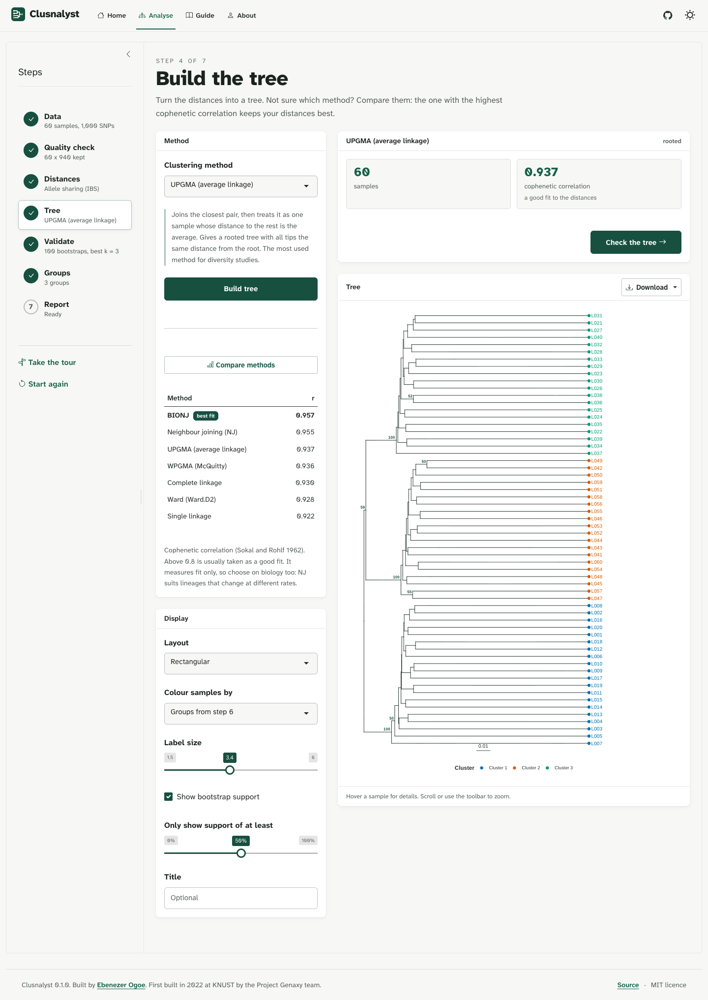
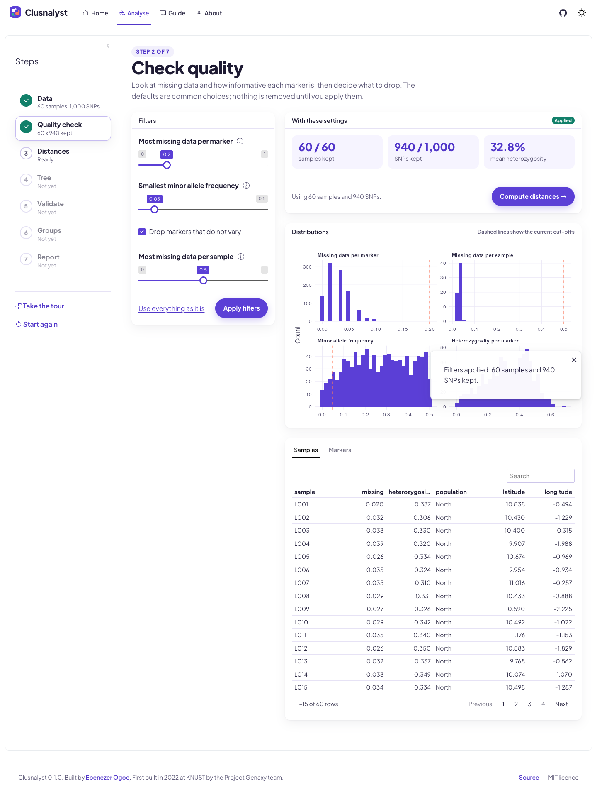
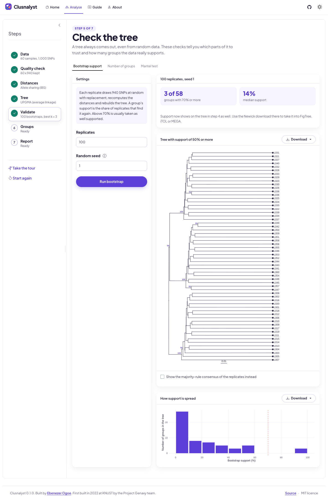
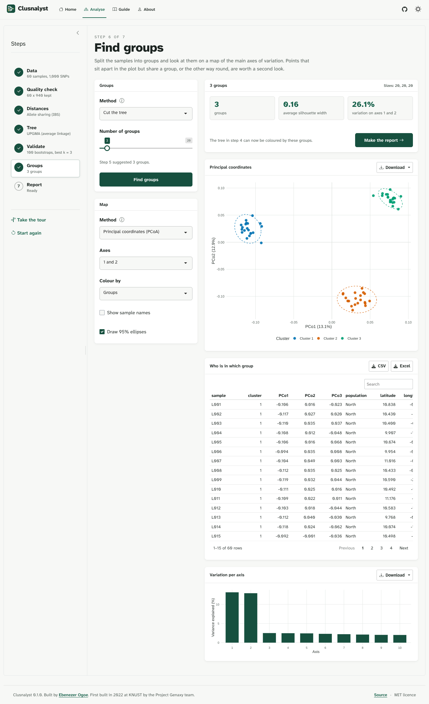
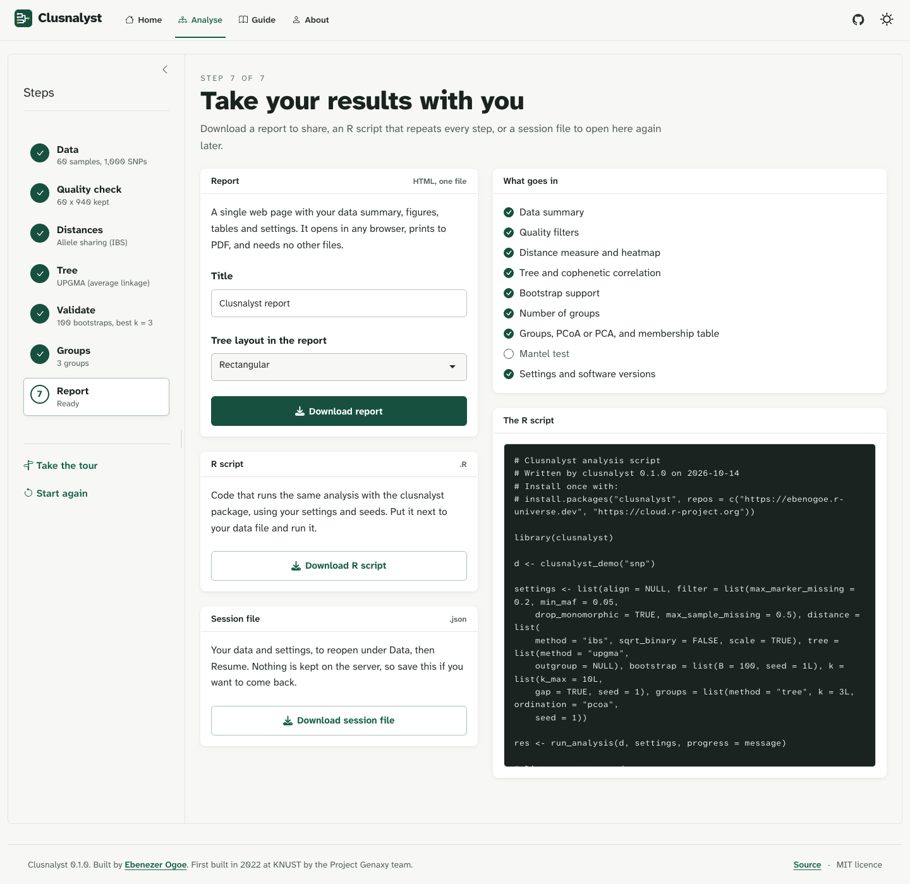

# Clusnalyst

<!-- badges: start -->
[](https://github.com/ebenogoe/clusnalyst/actions/workflows/R-CMD-check.yaml)
[](https://ebenogoe.r-universe.dev/clusnalyst)
<!-- badges: end -->

Clusnalyst is a point-and-click app for cluster analysis of molecular and trait data. You give it a marker table, a VCF, a HapMap file, a trait sheet or a FASTA file. It builds a tree, tells you how far to trust each branch and how many groups the data supports, and gives you a report and an R script that repeats every step.

**Try it in your browser:** https://ebenogoe.shinyapps.io/clusnalyst/



## Workflow

1. **Data.** Reads CSV, TSV and Excel tables, VCF, HapMap and FASTA. It works out the data type and whether markers are in rows or columns, and you can correct either. Sample information (population, origin, coordinates) can be added from a second table.
2. **Quality check.** Missing data per marker and per sample, minor allele frequency and heterozygosity, with filters. Unaligned sequences are aligned with ClustalOmega, ClustalW or MUSCLE through the msa package.
3. **Distances.** Jaccard, Dice and simple matching for bands; allele sharing (IBS), modified Rogers and Euclidean for SNPs; Euclidean, Manhattan and Gower for traits; K80, JC69, TN93 and p-distance for sequences.
4. **Tree.** UPGMA, WPGMA, single, complete and Ward linkage, neighbour joining and BIONJ, with optional rooting on an outgroup. A cophenetic correlation table ranks the methods for your distances.
5. **Validate.** Bootstrap support from resampled markers, the number of groups by silhouette width, the elbow and the gap statistic, and Mantel tests against a second matrix or against sample coordinates.
6. **Groups.** Cut the tree, or use PAM or k-means, and look at the groups on a PCoA or PCA plot.
7. **Report.** A self-contained HTML report, an R script, figures as PNG, SVG or PDF, tables as CSV or Excel, a Newick tree and a session file you can reopen later.

## Accepted data formats

| Data type | File formats | Distance measures |
|---|---|---|
| Dominant or binary markers (RAPD, AFLP, ISSR, presence and absence) | CSV, TSV, Excel with 0 and 1 | Jaccard, Dice, simple matching |
| SNP genotypes | CSV or Excel (AA/AG/GG, A/G, IUPAC or 0/1/2), VCF, HapMap | Allele sharing (IBS), modified Rogers, Euclidean |
| Measured and categorical traits | CSV, TSV, Excel | Euclidean, Manhattan, Gower |
| DNA sequences | FASTA, aligned or not | K80, p-distance, JC69, TN93 |
| Protein sequences | FASTA, aligned or not | p-distance, identity, similarity |

## Screenshots

| | |
|---|---|
|  |  |
|  |  |

## Installation

The hosted app has limits (30 MB files, 300 sequences, 1,000 bootstrap replicates). On your own computer there are none.

```r
install.packages("clusnalyst", repos = c("https://ebenogoe.r-universe.dev", "https://cloud.r-project.org"))
clusnalyst::run_app()
```

Every step is also a function, so you can script it:

```r
library(clusnalyst)
d <- read_markers("my_markers.csv")
d <- filter_data(d, max_marker_missing = 0.2, min_maf = 0.05)
dm <- compute_distance(d, "ibs")
tr <- build_tree(dm, "upgma")
boot <- bootstrap_tree(d, tr, "ibs", B = 500, seed = 1)
plot_tree(tr, support = boot$support, support_min = 50)
optimal_k(dm, tr, gap = TRUE)$best_silhouette
```

`run_analysis()` runs all of it from one settings list, which is what the app's R script download uses.

## Demo data

`clusnalyst_demo()` loads five datasets. Three are simulated and labelled as such: 60 lines from three populations with 1,000 SNPs, 30 accessions with 60 ISSR bands, and 40 cowpea-like accessions with mixed traits. The other two come from other packages: the woodmouse cytochrome b alignment from ape, and hemoglobin alpha protein sequences from msa. The scripts that make the simulated sets are in `data-raw/`.

## History

Clusnalyst began in 2022 as our final-year project at the Kwame Nkrumah University of Science and Technology (Project Genaxy: Ebenezer Ogoe, Michael Obeng and Stephen Amoako). That version was a single Shiny file. This one is a rewrite as an R package. Besides the new data types and checks, it fixes four problems in the original: the single and complete linkage options ran Ward's method, bootstrap support came from resampling the distance matrix rather than the markers, sessions on the hosted app shared their data, and aligned FASTA files crashed it. `NEWS.md` has the full list.

## Citation

Run `citation("clusnalyst")`, and cite the methods you use as well. The app's Guide page lists the references.

## Licence

MIT. Michael Obeng and Stephen Amoako are credited as contributors for the 2022 app.
