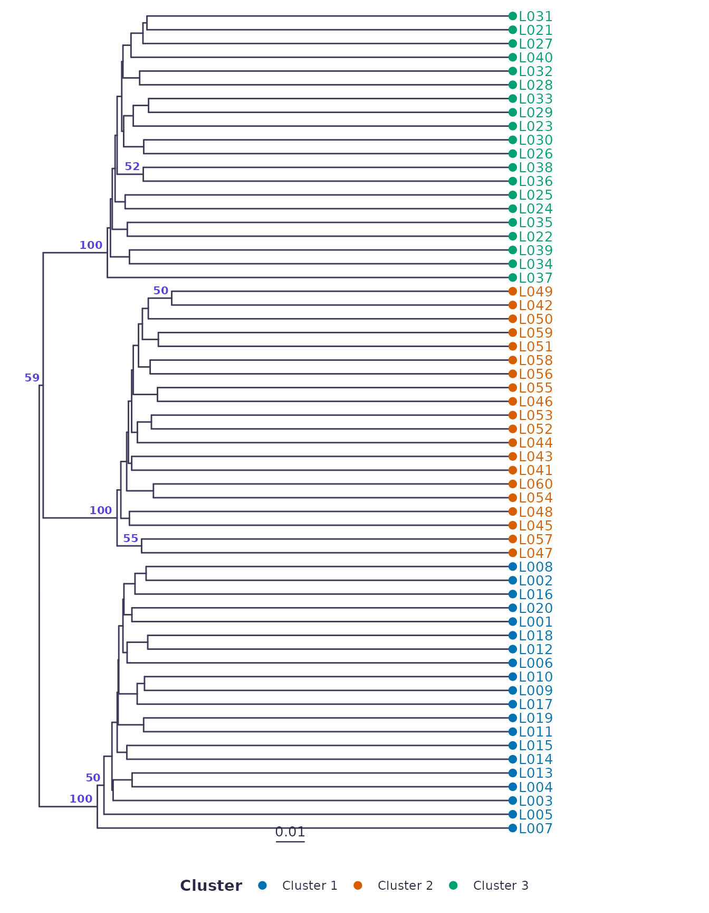
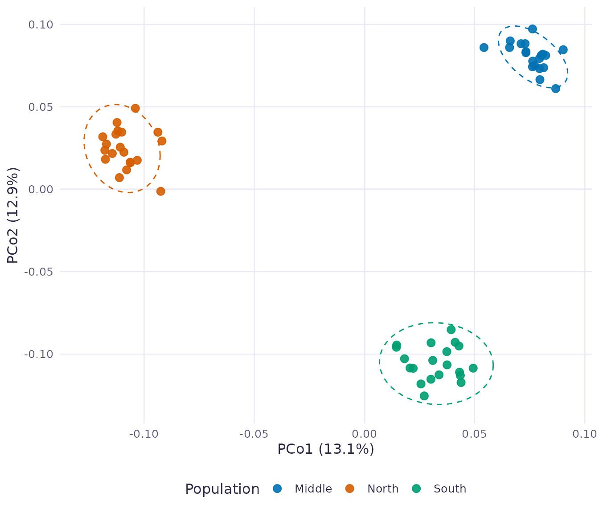

# Getting started

This article runs the same steps as the app, in code, on the simulated
SNP demo: 60 lines from three populations.

``` r

library(clusnalyst)
d <- clusnalyst_demo("snp")
d
#> <Clusnalyst data>
#>   Type:     SNP genotypes 
#>   Samples:  60 
#>   SNPs: 1000
#>   Metadata columns: population, latitude, longitude
```

## Quality check

``` r

q <- qc_summary(d)
q$n_monomorphic
#> [1] 5
d <- filter_data(d, max_marker_missing = 0.2, min_maf = 0.05)
d$filter$after
#> samples columns 
#>      60     940
```

## Distances and a tree

``` r

dm <- compute_distance(d, "ibs")
cophenetic_table(dm)
#>     method                   label cophenetic_r
#> 1    bionj                   BIONJ    0.9573621
#> 2       nj  Neighbour joining (NJ)    0.9554667
#> 3    upgma UPGMA (average linkage)    0.9373396
#> 4    wpgma        WPGMA (McQuitty)    0.9357848
#> 5 complete        Complete linkage    0.9297672
#> 6     ward          Ward (Ward.D2)    0.9276280
#> 7   single          Single linkage    0.9223428
tr <- build_tree(dm, "upgma")
```

## How much to trust it

``` r

boot <- bootstrap_tree(d, tr, "ibs", B = 100, seed = 1)
k <- optimal_k(dm, tr, k_max = 8, gap = TRUE)
k$best_silhouette
#> [1] 3
k$best_gap
#> [1] 3
plot_k(k)
```



``` r

groups <- partition(dm, 3, "tree", tree = tr)
plot_tree(tr, groups = setNames(paste("Cluster", groups), names(groups)),
          group_title = "Cluster", support = boot$support, support_min = 50)
#> Warning: Using `size` aesthetic for lines was deprecated in ggplot2 3.4.0.
#> ℹ Please use `linewidth` instead.
#> ℹ The deprecated feature was likely used in the ggtree package.
#>   Please report the issue at <https://github.com/YuLab-SMU/ggtree/issues>.
#> This warning is displayed once per session.
#> Call `lifecycle::last_lifecycle_warnings()` to see where this warning was
#> generated.
```



## Groups on a map

``` r

ord <- ordinate(dm, method = "pcoa")
plot_ordination(ord, groups = setNames(d$meta$population, rownames(d$meta)), group_title = "Population")
```



The simulated populations come back as the three clusters, and all three
are supported in 100% of bootstrap replicates. The splits inside each
population are not supported, which is what you would expect from lines
drawn from the same population.

## Isolation by distance

``` r

geo <- metadata_distance(d$meta, c("latitude", "longitude"))
m <- mantel_test(dm, geo, permutations = 999)
c(r = m$r, p = m$p)
#>         r         p 
#> 0.6710649 0.0010000
```

## The whole thing in one call

``` r

s <- default_settings(d)
res <- run_analysis(clusnalyst_demo("snp"), s)
cat(build_script(s, list(demo = "snp")))
#> # Clusnalyst analysis script
#> # Written by clusnalyst 0.1.0 on 2026-10-14
#> # Install once with:
#> # install.packages("clusnalyst", repos = c("https://ebenogoe.r-universe.dev", "https://cloud.r-project.org"))
#> 
#> library(clusnalyst)
#> 
#> d <- clusnalyst_demo("snp")
#> 
#> settings <- list(align = NULL, filter = list(max_marker_missing = 0.2, min_maf = 0.05, 
#>     drop_monomorphic = TRUE, max_sample_missing = 0.5, drop_empty_sites = TRUE), 
#>     distance = list(method = "ibs", sqrt_binary = FALSE, scale = TRUE), 
#>     tree = list(method = "upgma", outgroup = NULL), bootstrap = list(B = 100, 
#>         seed = 1), k = list(k_max = 10, gap = FALSE, seed = 1), groups = list(
#>         method = "tree", k = 3, ordination = "pcoa", seed = 1))
#> 
#> res <- run_analysis(d, settings, progress = message)
#> 
#> # Distances, tree and groups
#> dist_matrix <- as.matrix(res$dist)
#> res$tree
#> if (!is.null(res$groups)) table(res$groups)
#> 
#> # Plots
#> plot_tree(res$tree, groups = res$groups, group_title = "Cluster", support = res$boot$support)
#> if (!is.null(res$kres)) plot_k(res$kres)
#> if (!is.null(res$ord)) plot_ordination(res$ord, groups = res$groups, group_title = "Cluster")
#> 
#> # Save the tree in Newick format
#> tr <- res$tree$phylo
#> if (!is.null(res$boot)) tr$node.label <- round(res$boot$support)
#> ape::write.tree(tr, "clusnalyst_tree.nwk")
```
